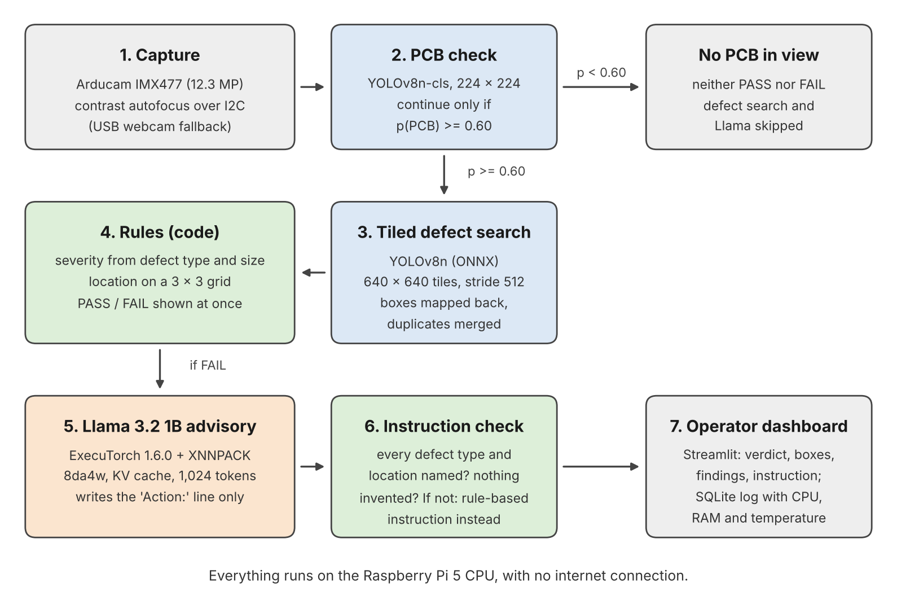

> The submitted versions of this report are [report/Final_Project_Report.pdf](report/Final_Project_Report.pdf) and [report/Final_Project_Report.docx](report/Final_Project_Report.docx). This page is the same text for reading on GitHub.

Final Project Report

**On-Device PCB Defect Inspection and Operator Advisory on a Raspberry Pi 5**

Bharat AI Hackathon

**Team:** Satyakam Mishra, Aryan Lahoti, Kavya Soni

**Guide:** Adithya Kumar

Indian Institute of Technology Gandhinagar

Code: github.com/Satyakam-Mishra/BharatAIHackathon

# 1. Summary

We built a PCB inspection station that runs entirely on a Raspberry Pi 5, with no internet connection. A camera photographs a bare board; a small classifier first checks that a PCB is in view; a YOLOv8n detector then searches the full-resolution photo tile by tile for six surface defect types; fixed rules assign each defect a severity and a location and give an immediate PASS or FAIL verdict; and Llama 3.2 1B Instruct, running on-device through ExecuTorch, writes a short rework instruction for the operator. The instruction is checked automatically and replaced by a rule-based one if it fails. Every inspection is logged locally with CPU, memory and temperature readings.

Key results: the defect detector reaches **mAP50 0.977** (precision 0.951, recall 0.983) on 1,806 tiles from 72 held-out photos; the PCB check classified all 359 held-out test pictures correctly; and Llama 3.2 1B generates **13 to 17 tokens per second** on the Pi 5 CPU with a peak memory use of about **1.27 GB**.

# 2. Problem and Goal

Bare PCBs are inspected for etching and drilling faults before components are fitted. Automated optical inspection machines are expensive, and cloud-based inspection needs a reliable network and sends production images off site. A detector alone also gives boxes, not instructions an operator can act on.

Our goal for the proof of concept was a low-cost station that (1) runs fully offline on an edge device, (2) finds small surface defects on a full-resolution photo, (3) gives an immediate PASS / FAIL verdict, (4) gives a short, correct rework instruction written by an on-device language model, (5) does not report PASS or FAIL when no PCB is in view, and (6) logs every inspection with hardware telemetry.

# 3. System Overview

*Figure 1. Inspection pipeline. Green steps are fixed code; blue steps are vision models; orange is the language model.*

The station has three possible outcomes: **PASS** (a PCB with no defects found), **FAIL** (a PCB with defects, with locations and an instruction) and **No PCB in view** (neither PASS nor FAIL, and the defect search and Llama are skipped).

# 4. Hardware

| **Component**         | **Model**                                                                            | **Role**                                                              |
|-----------------------|--------------------------------------------------------------------------------------|-----------------------------------------------------------------------|
| Single-board computer | Raspberry Pi 5, 8 GB RAM (Broadcom BCM2712, 4 × Cortex-A76, 2.4 GHz)                 | Runs all models, the dashboard and the log. CPU only; no accelerator. |
| Inspection camera     | Arducam IMX477 12.3 MP with motorised focus, on the Pi 5 camera port (22-pin ribbon) | Full-resolution 4056 × 3040 photos of the board                       |
| Focus motor           | Voice-coil lens motor on the camera's I2C bus (address 0x0C)                         | Driven by our autofocus code                                          |
| Fallback camera       | Logitech Brio 100 USB webcam (1280 × 720)                                            | Used automatically if no ribbon camera is found                       |
| Mounting              | Camera stand pointing down at the board                                              | Fixed working distance                                                |
| Storage               | microSD card                                                                         | Models (about 0.8 GB), code and the SQLite log                        |

# 5. Methodology

## 5.1 Dataset

We used the Peking University (PKU) PCB defect dataset (Kaggle: akhatova/pcb-defects): 693 labelled photos of bare boards, about 3,000 × 2,000 pixels each, with six defect classes: missing_hole, mouse_bite, open_circuit, short, spur and spurious_copper. The defects in this dataset were added artificially, and it contains no defect-free photos. We split the photos 80 / 10 / 10 into training, validation and test sets by whole photo, so that tiles from one photo never appear in two sets.

## 5.2 First attempt, and why we moved to tiling

Our first model was trained on a Roboflow version of the dataset in which every photo had been resized to 640 × 640 pixels. It reached an mAP50 of only 0.042. The reason was scale: after resizing, a typical defect was only about 14 pixels wide, too small for YOLOv8n to learn. We therefore kept the photos at full resolution and cut them into tiles, so a defect stays about 60 pixels wide.

## 5.3 Training the tiled defect detector

- **Tiles:** each photo is cut into 640 × 640 tiles with a stride of 512 pixels (128 pixels of overlap). A last tile is placed flush with the far edge, so the whole photo is covered. A defect that is cut by one tile's edge lies wholly inside the neighbouring tile.

- **Labels:** a box is kept in a tile if at least half of it is inside, and converted to YOLO format.

- **Empty tiles:** most tiles contain no defect; 15% of them were kept for training, so the model also learns what clean copper looks like.

- **Model and training:** YOLOv8n pretrained on COCO, fine-tuned with Ultralytics for up to 60 epochs (early stopping after 15 epochs without improvement), batch 16, 640 × 640 input, vertical flips added; on a Google Colab T4 GPU, about 1 to 1.5 hours.

- **Export:** the best weights were exported to ONNX for CPU inference on the Pi.

## 5.4 Tiled inference on the Pi

The Pi cuts each camera photo into tiles in exactly the same way (48 tiles for a 4056 × 3040 photo). The detector runs on each tile with a confidence threshold of 0.30; box coordinates are shifted back to the full photo; and duplicate detections from overlapping tiles are merged when two boxes of the same class overlap by more than 50% of the smaller box, keeping the higher confidence. An optional digital zoom (0.5× to 3×) can enlarge the photo first, so that defects appear at roughly the size seen in training when the camera is further away.

## 5.5 PCB check (no-PCB detection)

Without a check, the detector inspects whatever is under the camera and can report defects on a desk or a hand. We added a small classifier, YOLOv8n-cls with a 224 × 224 input and two classes, pcb and not_pcb, which runs on the whole picture before the defect search. If p(pcb) is below 0.60, the station reports "No PCB in view" and skips the defect search and Llama.

Training data was downloaded and generated, not collected at the station: the 693 PKU board photos plus 400 generated "board on a table" pictures (a board photo shrunk, rotated and placed on varied backgrounds) as pcb; and 1,000 everyday photos from Imagenette plus 300 generated plain scenes (blank paper, plain surfaces, wood grain, shadows) as not_pcb. 85% was used for training (20 epochs) and 15% held back for testing.

## 5.6 Severity and location rules

Decisions that must be repeatable are made by code, not by the language model.

| **Defect type** | **Base severity** | **Reason**                              |
|-----------------|-------------------|-----------------------------------------|
| open_circuit    | High              | Breaks a connection                     |
| short           | High              | Joins two separate nets                 |
| missing_hole    | High              | Component or via cannot be fitted       |
| mouse_bite      | Medium            | Narrowed track; may still conduct       |
| spur            | Medium            | Reduced spacing to a neighbouring track |
| spurious_copper | Low               | Isolated copper; often harmless         |

A defect is raised by one level if its longest side exceeds 3% of the picture's longest side. Its location is the cell of a 3 × 3 grid that contains the box centre (for example top-left or centre). Any defect gives FAIL; the verdict is shown as soon as the defect search finishes, before Llama runs.

## 5.7 On-device language model advisory

- **Model and runtime:** Llama 3.2 1B Instruct, exported with ExecuTorch 1.6.0 for the XNNPACK CPU backend (export settings in Section 8).

- **Division of work:** code writes the factual summary (how many defects of each type, severity and location), so it is always exact. Llama writes only the operator instruction, starting with "Action:".

- **Prompt:** a system message with the standard repair action for each defect type, two worked examples (few-shot), the findings, and the answer prefix "Action:" already filled in. Greedy decoding (temperature 0) and at most 120 new tokens.

- **Automatic check:** the answer must start with "Action:"; an unfinished last sentence is removed; every defect type found and every location must be named; and no defect type that was not found may be named. If any check fails, if Llama is not installed, or if it errors or takes more than 120 s, the dashboard shows a rule-based instruction instead and records why.

- **Process isolation:** Llama runs in its own Python environment and process (llama_runner.py), and receives the request as JSON. The vision environment and the ExecuTorch environment therefore never conflict, and Llama's memory is released after each answer.

## 5.8 Camera and autofocus

The Arducam's lens is moved by a voice-coil motor controlled over I2C. Our autofocus (focus.py) steps the motor through its range (every 64th of 1,024 positions, then every 16th around the best), measures sharpness on a small 800 × 600 preview stream as the variance of the Laplacian, and keeps the sharpest position. It runs each time the camera starts (about 10 seconds) and on a Refocus button, and the result is saved. The motor only holds its position while the camera runs, so the camera is kept open between inspections.

## 5.9 Dashboard, log and telemetry

The operator dashboard is a Streamlit web page served by the Pi and opened from any browser on the local network. It shows the verdict first, then the annotated photo, a findings table, the summary and the instruction with its source (Llama or rules). Each inspection is written to a local SQLite database (inspection_logs.db) with the defects, the advice, CPU load, memory use and CPU temperature; the dashboard also refreshes these readings every 2 seconds.

# 6. Results

## 6.1 Defect detector

| **Metric (test set: 1,806 tiles from 72 held-out photos)** | **Value** |
|------------------------------------------------------------|-----------|
| Precision                                                  | 0.951     |
| Recall                                                     | 0.983     |
| mAP50                                                      | 0.977     |
| mAP50-95                                                   | 0.564     |

The test tiles include all empty tiles from the test photos, so false alarms on clean copper are counted. For comparison, the first model trained on resized photos reached mAP50 0.042 (Section 5.2). The lower mAP50-95 shows that boxes are found reliably but are not always tightly fitted, which does not affect the verdict or the location.

## 6.2 PCB check

| **Test pictures (15% held out)**             | **Correct**      |
|----------------------------------------------|------------------|
| not_pcb: everyday photos and plain scenes    | 195 / 195        |
| pcb: PKU photos and generated board pictures | 164 / 164        |
| Overall                                      | 359 / 359 (100%) |

All test pictures were downloaded or generated in the same way as the training pictures, so this score shows the method works but does not yet prove reliability on photos from the station camera (see Section 9).

## 6.3 Speed and memory on the Raspberry Pi 5

| **Measurement**                                              | **Value**                              | **How measured**                          |
|--------------------------------------------------------------|----------------------------------------|-------------------------------------------|
| Defect search, one full camera photo (4056 × 3040, 48 tiles) | about 7 to 8 s (about 150 ms per tile) | Timer in the dashboard                    |
| Llama model load                                             | about 2.2 s                            | llama_runner.py statistics                |
| Llama time to first token                                    | 0.6 to 3.4 s                           | ExecuTorch runner statistics              |
| Llama generation speed                                       | 13 to 17 tokens/s                      | ExecuTorch runner statistics              |
| Llama peak memory                                            | about 1,268 MB (about 16% of 8 GB)     | Peak resident memory of the Llama process |
| Llama model file (.pte)                                      | 802.5 MB                               | File size                                 |
| Autofocus at camera start                                    | about 10 s                             | Observed                                  |
| CPU temperature at idle                                      | 44.4 °C (no active cooler)             | vcgencmd measure_temp                     |

The verdict appears as soon as the defect search finishes; the instruction follows a few seconds later, after Llama has loaded and generated its answer. The repository includes benchmark.py, which repeats these measurements on any set of test pictures and writes them to a file.

## 6.4 Offline operation

To show that nothing depends on the internet, we removed the Pi's default network route (sudo ip route del default), confirmed that an external address could not be reached (ping 8.8.8.8 failed with "Network is unreachable"), and then ran complete inspections, including the Llama advisory, from the dashboard. The laptop used to view the dashboard stays connected through the local network only.

# 7. Hardware Utilisation

- **CPU only:** all three models run on the four Cortex-A76 cores. The detector and the PCB check use ONNX models through Ultralytics; Llama uses ExecuTorch with XNNPACK, which uses the Arm NEON vector instructions.

- **Memory:** the Llama process peaks at about 1.27 GB of the 8 GB, leaving ample room for the vision models, the dashboard and the operating system. Llama runs in a separate process that exits after each answer, so its memory is not held while waiting.

- **Storage:** the Llama model is 802.5 MB on disk; the two YOLO models are much smaller (each under 15 MB); the SQLite log grows by one row per inspection.

- **Camera bus:** the full-resolution stream is used for inspection and a small 800 × 600 stream for autofocus, so focusing does not need full-size frames.

- **Thermal and load monitoring:** CPU load, memory use and CPU temperature (from /sys/class/thermal/thermal_zone0/temp) are shown live and stored with every inspection, so throttling would be visible.

# 8. Optimisation Techniques

1.  **Tiling instead of resizing.** Keeping the photo at full resolution and inspecting 640 × 640 tiles raised mAP50 from 0.042 to 0.977 without a larger model. The 128-pixel overlap ensures a defect on a tile edge is wholly inside a neighbouring tile, and duplicates are merged afterwards.

2.  **Small models.** YOLOv8n (the smallest YOLOv8) for detection and YOLOv8n-cls for the PCB check, exported to ONNX for CPU inference.

3.  **PCB check first.** A 224 × 224 classification of the whole picture decides whether the 48-tile defect search and Llama are needed at all, so pictures without a PCB cost only one small model run.

4.  **Quantised Llama with ExecuTorch.** Export settings: 8da4w quantisation (4-bit weights, 8-bit dynamic activations), 4-bit embedding table (group size 32), key-value cache, ExecuTorch's fused attention operator with the cache (SDPA), XNNPACK backend, 1,024-token context. The resulting model file is 802.5 MB; the original 16-bit weights of a 1.2-billion-parameter model would take about 2.5 GB.

5.  **Verdict before advice.** The PASS / FAIL verdict and the defect locations come from vision and rules and are shown at once; the slower language model only adds the instruction afterwards.

6.  **Code writes the facts, Llama writes the instruction.** Limiting Llama to one short, checked instruction (few-shot prompt, forced "Action:" prefix, greedy decoding, 120-token limit) keeps answers short and fast, and the automatic check with a rule-based fallback guarantees the operator always gets a correct instruction.

7.  **Separate environments and processes.** Vision and Llama run in separate Python environments, which avoids library conflicts and frees Llama's memory between answers.

8.  **Camera kept open and focused once.** The camera is opened once (about 2 s) and autofocused at start; later captures reuse it, and focus uses a small preview stream.

# 9. Limitations

- **Real boards differ from the training data.** On our own fabricated board, the detector gave false missing_hole detections at low confidence (0.3 to 0.6). Likely causes: the defects in the PKU dataset are artificial and it has no defect-free boards; our board has a different style; and the camera's scale (about 15 to 20 pixels per mm) was lower than in the training photos (about 40 to 50 pixels per mm). Moving the camera closer improved the scale. The demonstration therefore uses printed held-out test photos from the dataset.

- **PCB check not yet measured on station photos.** Its 100% score is on downloaded and generated pictures. Unusual scenes under the camera (for example a printed text page) could still be misclassified.

- **Speed.** A full 12.3 MP photo takes about 7 to 8 s on the CPU, which is acceptable for a manual station but not for a fast production line.

# 10. Future Work

- Fine-tune the detector on photos of real boards taken with the station camera, including defect-free boards, to remove the false alarms.

- Retrain the PCB check with station-camera photos (already supported by the notebook and collect_photos.py).

- Reduce inspection time by running the detector on an NPU (for example the Raspberry Pi AI HAT+) or by inspecting only the board area found by the PCB check.

- Drive a reject mechanism from the Pi's GPIO pins on FAIL.

# 11. Software, Data and Licences

| **Item**                                       | **Version or source**              | **Licence**                                          |
|------------------------------------------------|------------------------------------|------------------------------------------------------|
| Ultralytics YOLOv8 (detection, classification) | Ultralytics package, ONNX export   | AGPL-3.0 (the repository is released under AGPL-3.0) |
| ExecuTorch with XNNPACK                        | 1.6.0 (PyTorch 2.15.0, CPU build)  | BSD-style                                            |
| Llama 3.2 1B Instruct                          | Meta, via Hugging Face             | Llama 3.2 Community Licence                          |
| PKU PCB defect dataset                         | Kaggle: akhatova/pcb-defects       | Public research dataset                              |
| Imagenette (not_pcb pictures)                  | fast.ai (a subset of ImageNet)     | Research use                                         |
| Streamlit, OpenCV, Picamera2, psutil, SQLite   | Python packages on Raspberry Pi OS | Open source                                          |

All training notebooks (defect detector, PCB check and Llama export) are in the training folder of the repository, so every model can be reproduced.
