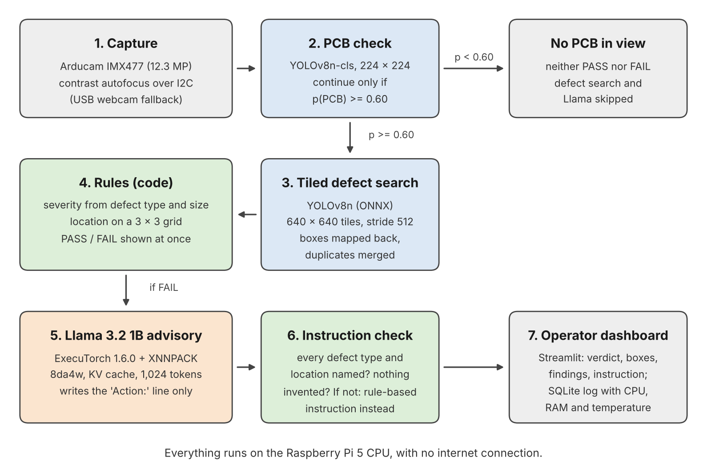

# On-Device PCB Defect Inspection and Operator Advisory

An offline PCB inspection station on a Raspberry Pi 5, built for the Bharat AI Hackathon.

A camera photographs a bare board. A small classifier checks that a PCB is in view, a YOLOv8n detector searches the full-resolution photo tile by tile for six defect types, fixed rules give an immediate PASS / FAIL verdict with severity and location, and **Llama 3.2 1B Instruct running on-device through ExecuTorch** writes a checked rework instruction for the operator. Nothing needs the internet.

**Report:** [report/Final_Project_Report.pdf](report/Final_Project_Report.pdf) (also as [.docx](report/Final_Project_Report.docx) and [Markdown](PROJECT_REPORT.md)).



## Three outcomes

| Under the camera | Result |
|---|---|
| A PCB with no defects found | **PASS** |
| A PCB with defects | **FAIL**, with boxes, severity, location and an instruction |
| No PCB (empty stand, hand, paper...) | **No PCB in view**: neither PASS nor FAIL; defect search and Llama skipped |

## Results

| | |
|---|---|
| Defect detector (1,806 test tiles from 72 held-out photos) | precision 0.951, recall 0.983, **mAP50 0.977**, mAP50-95 0.564 |
| PCB check (359 held-out downloaded and generated pictures) | 359 / 359 correct |
| Defect search on the Pi 5, one 4056 × 3040 camera photo (48 tiles) | about 7 to 8 s |
| Llama 3.2 1B on the Pi 5 CPU (ExecuTorch 1.6.0, XNNPACK, 8da4w) | 13 to 17 tokens/s, peak memory about 1.27 GB, model file 802.5 MB |

`benchmark.py` repeats the speed and memory measurements on your own pictures.

## Hardware

- Raspberry Pi 5, 8 GB
- Arducam IMX477 12.3 MP camera with motorised focus (autofocus by `focus.py`), on the Pi 5 camera port
- Optional: any USB webcam (used automatically if no ribbon camera is found)

## Repository

| File | What it does |
|---|---|
| `dashboard.py` | Streamlit operator dashboard: capture or upload, verdict, boxes, findings, instruction, telemetry |
| `vision.py` | PCB check (`pcb_gate.onnx`), tiled defect search (`yolo_pcb.onnx`), duplicate merging |
| `camera.py` | Ribbon camera (Picamera2) with autofocus at start, or a USB webcam |
| `focus.py` | Focus motor control over I2C and contrast autofocus; also a command-line tool |
| `llm_engine.py` | Severity and location rules, prompt, instruction check, rule-based fallback |
| `llama_runner.py` | Runs Llama 3.2 1B with ExecuTorch (in the separate `et_env` environment) |
| `hardware_logger.py` | SQLite log of inspections with CPU, memory and temperature |
| `pipeline.py` | Inspect one picture from the command line |
| `benchmark.py` | Measure speed, memory and temperature for the report |
| `collect_photos.py` | Take training photos with the station camera |
| `download_dataset.py` | Download the PKU PCB dataset from Kaggle |
| `training/` | Colab notebooks: defect detector (tiled), PCB check, Llama export. `early_roboflow_attempt/` is the first, unsuccessful approach |
| `pcb_gate/gate_metrics.txt` | Test scores of the PCB check |
| `no-pcb-check-instructions.md` | Step-by-step guide for training and testing the PCB check |

The model files (`*.onnx`, `*.pte`) are not stored in Git because of their size; the notebooks in `training/` produce them.

## Setup on the Raspberry Pi

```bash
sudo apt install python3-picamera2
git clone https://github.com/Satyakam-Mishra/BharatAIHackathon.git
cd BharatAIHackathon

# Vision and dashboard environment
python3 -m venv --system-site-packages pcb_env
source pcb_env/bin/activate
pip install torch torchvision --index-url https://download.pytorch.org/whl/cpu
pip install -r requirements.txt

# Llama environment (separate)
python3 -m venv ~/et_env
~/et_env/bin/pip install -r requirements-llm.txt
```

Model files to copy onto the Pi:

- `yolo_pcb.onnx` and `pcb_gate.onnx` into this folder
- `llama3_2_1b_main.pte` and `tokenizer.model` into `~/llama/`

For the Arducam IMX477, add `dtoverlay=imx477` and set `camera_auto_detect=0` in `/boot/firmware/config.txt`, then reboot.

## Running

```bash
source pcb_env/bin/activate
streamlit run dashboard.py --server.address 0.0.0.0 --server.headless true
```

Open `http://pcb-pi.local:8501` from a browser on the same network.

Other checks:

```bash
python3 pipeline.py path/to/board.jpg          # inspect one picture
python3 benchmark.py path/to/test_pictures     # speed, memory, temperature
python3 llm_engine.py                          # rules and advisory on four test cases
~/et_env/bin/python llama_runner.py --test     # Llama on its own
```

## Data and licences

- Dataset: Peking University PCB defect dataset (Kaggle: `akhatova/pcb-defects`)
- Ultralytics YOLOv8 is licensed under AGPL-3.0; this repository is therefore released under the same licence (see `LICENSE`)
- Llama 3.2 is used under the Llama 3.2 Community Licence

## Team

Satyakam Mishra, Aryan Lahoti, Kavya Soni. Guide: Adithya Kumar. IIT Gandhinagar.
